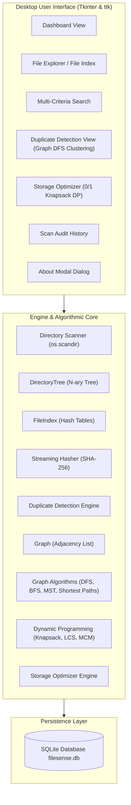
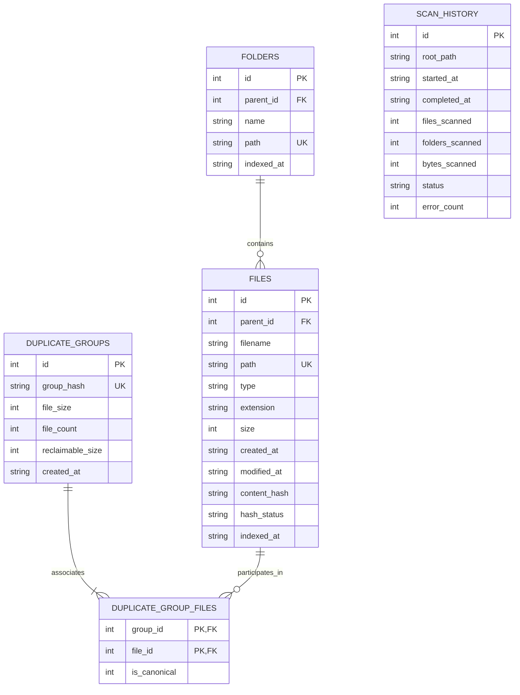

# FileSense — System Architecture & Design
**Course**: Data Structures and Algorithms-II (CCSE0301)  
**Project**: High-Performance Local File Indexing and Redundancy Detection Tool  
**SDG Alignment**: SDG 9: Industry, Innovation and Infrastructure  

---

## 1. HIGH-LEVEL ARCHITECTURAL OVERVIEW

FileSense is architected around a layered, modular desktop design that cleanly decouples filesystem operations, persistent storage, in-memory data structures, and the Tkinter GUI.

---

## 2. MODULAR COMPONENT SPECIFICATION

| Component | File Path | Primary Responsibilities |
|---|---|---|
| **App Configuration** | `app/config.py` | Constants, exclusions, categories, byte formatters. |
| **Tree Data Structure**| `app/tree_structure.py`| N-ary directory tree, preorder/postorder traversals, size caching. |
| **Streaming Hasher** | `app/hashing.py` | Chunked 1 MiB SHA-256 calculation, byte verification, error handling. |
| **Database Manager** | `app/database.py` | SQLite schema, WAL mode, transactions, scan logs, duplicate storage. |
| **Hash Table Index** | `app/file_index.py` | In-memory hash tables for filename, ext, size, hash, and fast compound search. |
| **Directory Scanner** | `app/scanner.py` | Recursive traversal, symlink safety, progress callbacks, incremental sync. |
| **Duplicate Detector** | `app/duplicate_detector.py` | 3-stage detection pipeline (Size grouping $\to$ SHA-256 $\to$ Byte checking). |
| **Graph Model** | `app/graph_structure.py`| Adjacency list graph representation of verified duplicate equivalence cliques. |
| **Graph Algorithms** | `app/graph_algorithms.py`| DFS, BFS, Warshall, Kruskal (DSU), Prim, Dijkstra, Bellman-Ford, Floyd-Warshall. |
| **Dynamic Programming**| `app/dynamic_programming.py`| 0/1 Knapsack, Resource Allocation, LCS, Matrix Chain Multiplication. |
| **Storage Optimizer** | `app/storage_optimizer.py`| Canonical retention rules, safe non-destructive recommendations, CSV export. |
| **Benchmark Tool** | `app/benchmark.py` | Empirical comparison of in-memory index vs raw disk I/O search. |
| **Main Orchestrator** | `ui/main_window.py` | Window management, persistent sidebar, worker threading, view switching. |

---

## 3. SQLITE DATABASE SCHEMA & PERSISTENCE

FileSense persists metadata and scan logs into a local SQLite database (`data/filesense.db`) using Write-Ahead Logging (`PRAGMA journal_mode = WAL;`) and enforced Foreign Keys.

### Database Performance Indexes
- `idx_files_hash`: Fast lookup by SHA-256 hash.
- `idx_files_size`: Fast candidate selection by byte size.
- `idx_files_ext`: Fast filtration by file extension.
- `idx_files_filename`: Substring and exact name matching.
- `idx_files_path`: Path resolution and subtree queries.

---

## 4. INCREMENTAL INDEXING WORKFLOW

When the user initiates a rescan or incremental update on an existing directory:
1. `DirectoryScanner` reads file modification time (`st_mtime`) and size (`st_size`).
2. If path exists in database and `(size, mtime)` are unchanged:
   - Existing valid SHA-256 hash is preserved without re-reading the file.
3. If file has changed on disk:
   - Metadata is updated and hash status is reset to `PENDING` for rehashing.
4. If file is newly discovered:
   - Inserted into `files` table and added to in-memory hash index.
5. If file was deleted from disk:
   - `delete_files_not_in_paths` prunes stale records from SQLite and cleans in-memory indexes.

---

## 5. THREADING & CONCURRENCY MODEL

To ensure the desktop UI remains 100% responsive:
- **Filesystem Scanning** and **Duplicate Hashing** run inside background worker threads (`threading.Thread(daemon=True)`).
- Progress updates and error alerts are scheduled onto the Tkinter main thread using `root.after(0, callback)`.
- Cancellation is supported via `threading.Event`, allowing immediate and safe aborting of active scans without corrupting database transactions.

---

## 6. STORAGE OPTIMIZER SAFETY PROTOCOLS

FileSense adheres strictly to non-destructive principles:
1. **Default workflow is Recommendation-Only**: User files are never deleted automatically.
2. **Canonical Master Copy Retention**: Every duplicate cluster designates one canonical file (e.g. oldest creation date or shortest path) that is strictly excluded from cleanup actions.
3. **Multi-point Pre-Deletion Verification**: If verified deletion is explicitly triggered:
   - Confirms master copy still exists on disk.
   - Re-checks master copy SHA-256 hash.
   - Confirms target file exists, has expected size, and matches expected SHA-256 hash.
   - Executes byte-by-byte check between target and master copy.
   - Only then removes the redundant copy.
